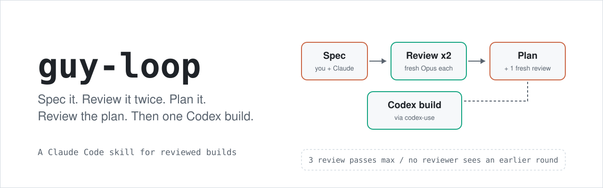
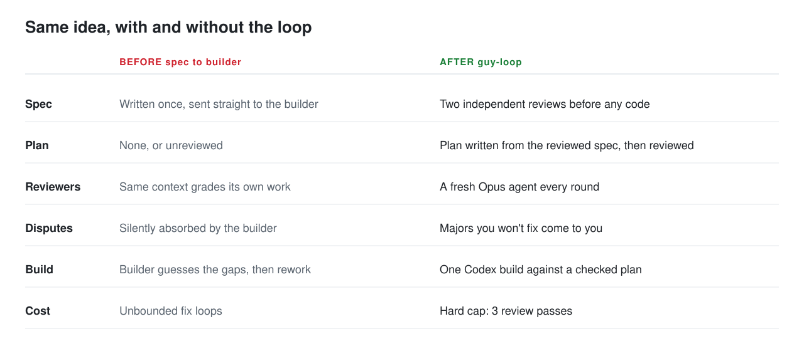
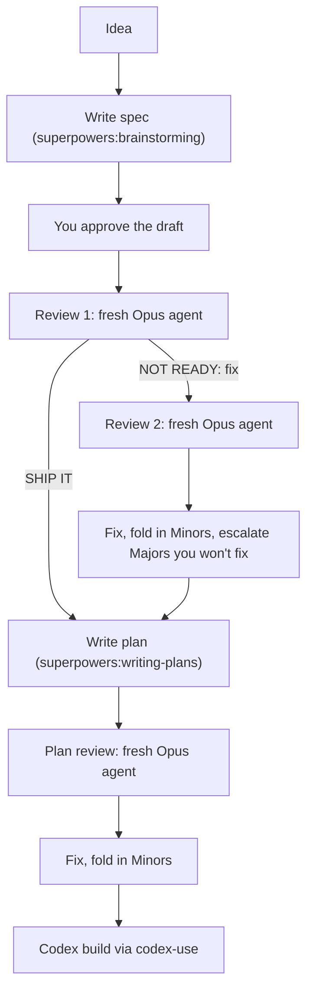

<p align="center">
  <picture>
    <source media="(prefers-color-scheme: dark)" srcset="assets/hero-dark.svg">
    
  </picture>
</p>

<p align="center">
  <a href="LICENSE"></a>
  
  
</p>

A Claude Code skill that takes an idea through a spec, two independent reviews, a reviewed plan, and then one Codex build.

## Quick start

```
git clone https://github.com/guydotan55/guy-loop ~/.claude/skills/guy-loop
```

Install the three skills it depends on:

- [superpowers](https://github.com/obra/superpowers) (`brainstorming` and `writing-plans`)
- [adversarial-review](https://github.com/guydotan55/adversarial-review)
- [codex-use](https://github.com/guydotan55/codex-use)

Then, in a Claude Code session inside a git repo:

```
/guy-loop add CSV export to the reports page
```

Claude brainstorms the spec with you. Once you approve the draft, the loop runs on its own until a Blocker, a Major that is your call, or the Codex launch dialog. If you already have a spec on disk, name it and the loop starts at the review step.

## Why use it

Handing a one-shot spec straight to a coding agent works until the spec has a hole, and then you pay for the hole in rework. This skill puts two cheap checkpoints before the expensive step:

- **Independent spec review.** Up to two rounds, each by a new Opus agent running [adversarial-review](https://github.com/guydotan55/adversarial-review). Round 1 says SHIP IT and round 2 is skipped.
- **A reviewed plan.** The plan is written from the reviewed spec, then reviewed once more by another fresh agent that also checks the plan covers the whole spec.
- **One build.** Only then does [codex-use](https://github.com/guydotan55/codex-use) hand the plan to Codex, in a worktree.

The main session stays the author: it fixes findings between rounds. Reviewers only read and report.

<picture>
  <source media="(prefers-color-scheme: dark)" srcset="assets/before-after-dark.svg">
  
</picture>

## Workflow



## Why fresh reviewers

Every review is a newly spawned agent. No reviewer sees an earlier round's reasoning, only the artifact and an evidence-only brief: your locked decisions, the out-of-scope list, facts already verified, and (in round 2) what was found and what changed. A reviewer that has read its own earlier verdict tends to defend it; a fresh one has nothing to defend. So the skill never sends a message to a previous reviewer, and the brief never contains reasons the artifact is good.

## The caps

- **Max 3 review passes**: 2 on the spec, 1 on the plan.
- Round 2 happens only if round 1 was NOT READY.
- The plan review is mandatory; only spec round 2 is conditional.
- After round 2, reviewing stops. A Major you would rather not fix is your call, listed rather than deferred. A remaining Blocker stops the loop and waits for you.
- Only your explicit "do another round" adds a pass.

Why: review has diminishing returns, and every pass costs Opus tokens and time. Three passes catch the structural problems; more mostly rediscover taste.

## Requirements

- Claude Code
- [superpowers](https://github.com/obra/superpowers), [adversarial-review](https://github.com/guydotan55/adversarial-review) and [codex-use](https://github.com/guydotan55/codex-use) installed as skills
- Codex CLI, logged in (see codex-use for details)
- Access to Opus for the reviewer agents
- A worktree skill if you have one; otherwise `git worktree add ../<repo>-<task> -b <branch>` is used

If you install somewhere other than `~/.claude/skills/guy-loop`, the reviewer brief still expects adversarial-review at `~/.claude/skills/adversarial-review/SKILL.md`.

## How it works

Step 0 collects the review inputs once (decisions, out-of-scope, verified facts) and sets up the worktree. Step 1 writes the spec. Steps 2 and 4 dispatch the reviewers. Step 3 writes the plan. Step 5 launches Codex through codex-use, whose model and effort dialog is the checkpoint. Step 6 reports spec path, verdicts, changes, open items and the Codex run id. Everything is in [SKILL.md](SKILL.md).

## Safety

- The build step runs Codex via codex-use **without a sandbox**. Read [codex-use's Safety section](https://github.com/guydotan55/codex-use#safety) before using this skill, and do not run the loop on untrusted repos, specs or plans.
- Invoking the skill pre-approves exactly 3 Opus review passes. Opus reviews cost tokens; the cap is the budget.
- If Codex is logged out or out of credit, the loop stops and asks you. It does not switch to another builder.

See also [SECURITY.md](SECURITY.md).

## License

[MIT](LICENSE)
